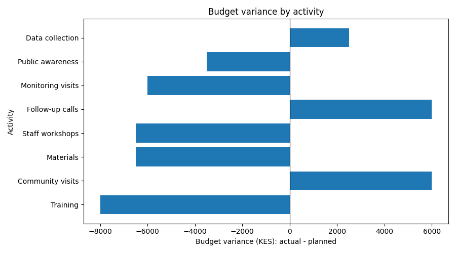

# NGO Project Budget and Activity Tracking (Python)

A pandas and NumPy analysis comparing planned and actual spending with planned and delivered outputs for a fictional NGO. Built as practice for a Monitoring, Evaluation and Learning (MEL) role.

> All data is fictional and created for learning. Findings do not describe a real programme.

## Questions answered
- Data quality checks (missing values, numeric types)
- Budget variance (KES and %) per activity
- Output delivery % per activity
- Over budget vs within/under budget labels
- Activities that overspent AND delivered under 100% of outputs
- Total planned budget, actual spend, total variance
- Overall output delivery
- Horizontal bar chart of budget variance

## Key results
| Metric | Value |
|---|---|
| Total planned budget | KES 715,000 |
| Total actual spend | KES 699,000 |
| Total variance | KES -16,000 (-2.2%) |
| Overall output delivery | 93.4% |

- Follow-up calls was the only activity that overspent (+13.3%) and under-delivered (90%).
- Community visits overspent by 6.7% but delivered 113.3% of planned outputs.
- Underspending is not automatically good: Training and Monitoring visits underspent but delivered only 90% of outputs.

## Tools
Python, pandas, NumPy, Matplotlib

## How to run
pip install pandas numpy matplotlib
python budget_tracking.py

## Limitations
Small fictional dataset, a single period, and no information on why variances occurred.
